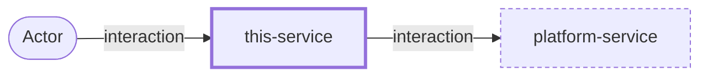
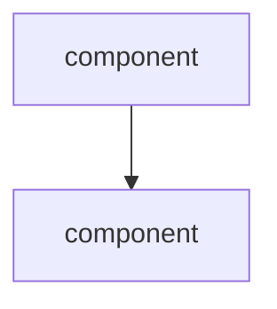
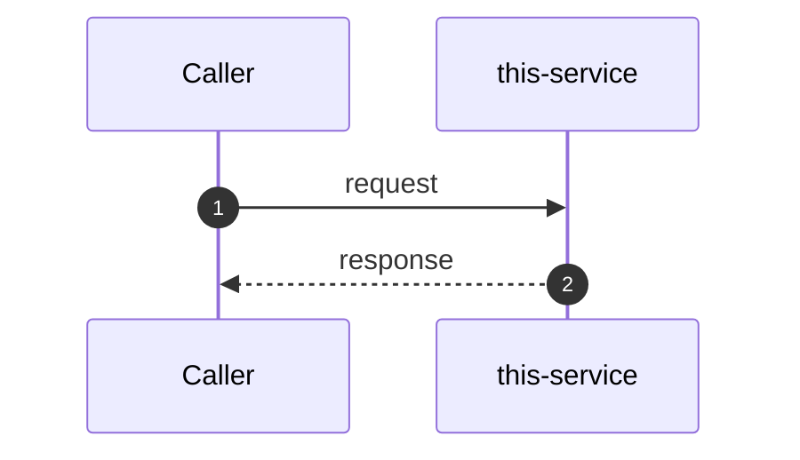

<!-- docs-kit: nav="Architecture" -->
# {{NAME}}: Architecture

{{NAV}}

{{META}}

<!--
TEMPLATE: {{DOCS_PATH}}/01-architecture.md
Do not rename, reorder, add or remove the numbered H2 headings. H3 subsections may be added freely.
If a section does not apply, keep the heading and write: _Not applicable._ followed by one sentence saying why.
Describe current behaviour in the present tense. History belongs in git and in pull requests.
-->

## 1. Overview

<Architectural style (event-driven consumer, GraphQL API, CronJob, ...), the main responsibilities, and the
qualities that shape the design (idempotency, throughput, tenant isolation, ...).>

## 2. System context

<!-- Required diagram: flowchart showing actors and every external system this service talks to. -->

| Actor or system | Relationship | Interface |
|---|---|---|
| <name> | <what it does with this service> | <GraphQL / NATS / GCS / ...> |

## 3. Components

<!-- Required diagram: flowchart of the main internal components (packages) and how they connect. -->

| Component | Package / path | Responsibility |
|---|---|---|
| <name> | <link to the package, e.g. ../internal/package> | <responsibility> |

## 4. Runtime flows

<!-- One H3 per significant flow, primary (happy) path first. Each flow needs a sequenceDiagram
(use autonumber) followed by short numbered notes on the steps that need explanation. -->

### 4.1 <Primary flow>

## 5. Concurrency and scaling model

<Workers, goroutines, pools, batching, back-pressure, horizontal scaling assumptions, shared state.>

## 6. Failure handling and resilience

| Failure | Behaviour | Recovery |
|---|---|---|
| <dependency down, bad input, ...> | <retry / nak / DLQ / fail fast> | <automatic / operator action> |

<Also cover idempotency, timeouts and graceful shutdown.>

## 7. External dependencies

| Dependency | Purpose | Protocol | If unavailable |
|---|---|---|---|
| <name> | <purpose> | <GraphQL / NATS / HTTPS / SQL> | <impact> |

## 8. Key design decisions

| Decision | Rationale | Reference |
|---|---|---|
| <decision> | <why, and the alternatives considered> | <document section, code or ticket> |

## 9. Known limitations and technical debt

- <limitation, with ticket or file reference where one exists>
