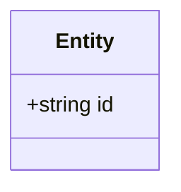

<!-- docs-kit: nav="Data model" -->
# {{NAME}}: Data Model

{{NAV}}

{{META}}

<!--
TEMPLATE: {{DOCS_PATH}}/02-data-model.md
Do not rename, reorder, add or remove the numbered H2 headings. H3 subsections may be added freely.
If a section does not apply, keep the heading and write: _Not applicable._ followed by one sentence saying why.
Message payload schemas live in 03-messaging.md; link to them instead of repeating them here.
-->

## 1. Overview

<Which data the service owns, which it only reads, and where the authoritative copy of each lives.>

## 2. Domain model

<!-- Required diagram: classDiagram or erDiagram of the core domain types and their relationships. -->

| Entity | Description | Defined in |
|---|---|---|
| <type> | <meaning> | <link to the file that defines it> |

## 3. Persistent storage

<!-- One H3 per store the service reads or writes: PostgreSQL, Neo4j, GCS, NATS KV, Redis, in-memory caches.
For SQL stores include an erDiagram and a column table per table. For GCS include the object-path layout.
State ownership (owner / reader / writer) for each store. -->

### 3.1 <Store>

## 4. Schemas and contracts

<GraphQL schema files, configuration documents, rule files, file formats and their validation rules.
Link to schema files rather than copying them in full.>

## 5. Data lifecycle and retention

<Creation, update, deletion, TTLs, retention, migrations (where they live and how they are applied).>

## 6. Tenancy and data isolation

<How customer / tenant scoping appears in the data (columns, keys, headers, object paths) and how isolation
is enforced.>
