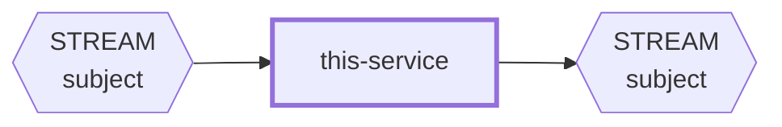
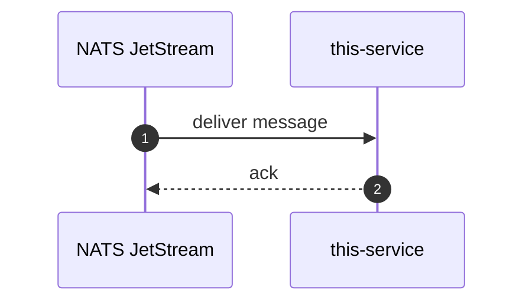

<!-- docs-kit: nav="Messaging" -->
# {{NAME}}: Messaging

{{NAV}}

{{META}}

<!--
TEMPLATE: {{DOCS_PATH}}/03-messaging.md
Do not rename, reorder, add or remove the numbered H2 headings. H3 subsections may be added freely.
If a section does not apply, keep the heading and write: _Not applicable._ followed by one sentence saying why.
Use the default stream / subject / consumer / bucket names from code and name the environment variable that
overrides each. Conventions shared by several services belong in the platform-level messaging document (the
repository-root docs/03-messaging.md in a monorepo); link to it instead of repeating it.
-->

## 1. Overview

<!-- Required diagram: flowchart LR of every stream, subject and KV bucket this service touches, with the
counterpart services on the other side. Streams and buckets use the hexagon shape {{"..."}}. -->

| Direction | Stream | Subject | Counterpart |
|---|---|---|---|
| Consumes | `STREAM` | `subject` | <producer service> |
| Publishes | `STREAM` | `subject` | <consumer service> |

## 2. Messaging infrastructure

<NATS JetStream connection (URL, TLS, NKey authentication), which service creates / manages each stream,
and any other transport (Pub/Sub, WebSocket, HTTP callbacks).>

## 3. Consumed messages

<!-- One H3 per consumed subject. Property table first, then the payload (field table + JSON example). -->

### 3.1 <subject>

| Property | Value |
|---|---|
| Stream | `STREAM` (`NATS_STREAM_...`) |
| Subject | `subject` (`NATS_SUBJECT_...`) |
| Durable consumer | `name` (`NATS_CONSUMER_...`) |
| Delivery / ack policy | <deliver policy, explicit ack, AckWait, MaxDeliver, MaxAckPending> |
| Producer | <service> |
| Handler | <link to the handler> |

## 4. Published messages

<!-- One H3 per published subject: property table (stream, subject, trigger, consumers, Msg-Id / dedup),
then the payload (field table + JSON example). -->

### 4.1 <subject>

## 5. Key-value buckets and other NATS resources

<KV buckets (name, key format, value, TTL, history), object stores, request/reply subjects.>

## 6. Delivery semantics and error handling

<!-- Required diagram: sequenceDiagram of a message's lifecycle: fetch, process, ack / nak / term,
in-progress heartbeats, redelivery and dead-lettering. -->

<At-least-once vs exactly-once, idempotency keys, poison messages, dead-letter handling.>

## 7. Headers, correlation and tracing

| Header | Direction | Meaning |
|---|---|---|
| <header> | <in / out> | <meaning> |
