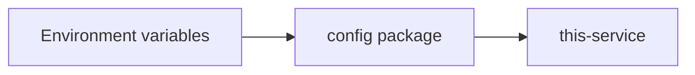

<!-- docs-kit: nav="Configuration" -->
# {{NAME}}: Configuration

{{NAV}}

{{META}}

<!--
TEMPLATE: {{DOCS_PATH}}/06-configuration.md
Do not rename, reorder, add or remove the numbered H2 headings. H3 subsections may be added freely.
If a section does not apply, keep the heading and write: _Not applicable._ followed by one sentence saying why.
Defaults must come from code (not from .env samples). "Required" means the service refuses to start without it.
-->

## 1. Overview

<!-- Required diagram: flowchart of configuration sources (environment / Keeper secret, Vault, config
registry, config files, flags) flowing into the service, with precedence where it matters. -->

<Sources, precedence, and where configuration is loaded (link the config package).>

## 2. Environment variables

<!-- Group into H3s. Suggested groups, omitting any with no variables: Service, Messaging (NATS),
Data stores, Authentication and secrets, External services, Observability, Tuning and feature flags. -->

### 2.1 Service

| Variable | Required | Default | Description |
|---|---|---|---|
| <VARIABLE> | Yes / No | <default> or — | <description> |

## 3. Configuration files

<Files read at startup or hot-reloaded (YAML rules, JSON configs, schema files), their location and format.>

## 4. Dynamic configuration

<Configuration fetched or reloaded at runtime (for example an effective config from a registry, schema
polling) and how changes propagate.>

## 5. Environment-specific settings

<How values differ between local, development, staging and production; where deployed values are managed.>

## 6. Startup validation

<Which settings are validated at boot and what happens when they are missing or invalid.>
