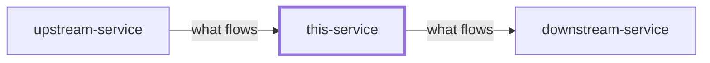

<!-- docs-kit: nav="Overview" -->
# {{NAME}}: Overview

{{NAV}}

{{META}}

<!--
TEMPLATE: {{DOCS_PATH}}/README.md
Replace every <placeholder>. Delete these guidance comments when done.
Do not rename, reorder, add or remove the numbered H2 headings. H3 subsections may be added freely.
If a section does not apply, keep the heading and write: _Not applicable._ followed by one sentence saying why.
-->

<One paragraph: what the service does, who or what calls it, and where it sits in the platform.>

## 1. At a glance

<!-- Keep every row. Use "None" where a row does not apply. Link files with relative links. -->

| | |
|---|---|
| **Purpose** | <one line> |
| **Platform role** | <e.g. "Ingress", "Stage 3 — normalization" or "Supporting — configuration"> |
| **Language / runtime** | <language and version, e.g. Go from go.mod> |
| **Deployables** | <each binary under cmd/ and its kind: long-running Deployment, CronJob, operator CLI> |
| **Inbound interfaces** | <GraphQL / HTTP / WebSocket endpoints and NATS consumers> |
| **Outbound dependencies** | <platform services, cloud services> |
| **Data stores** | <PostgreSQL, Neo4j, GCS, NATS KV, Redis — or None> |
| **Messaging** | Consumes: <streams>. Publishes: <streams>. |
| **Authentication** | Inbound: <mechanism>. Outbound: <mechanism>. |
| **Deployment** | GKE namespace <namespace>, Deployment <deployment>, workflow <link to the deploy workflow under {{ROOT}}/.github/workflows/> |

## 2. Responsibilities

<!-- Two short bullet lists. "Does not" prevents readers from assuming responsibilities that live elsewhere. -->

**Does**

- <responsibility>

**Does not**

- <responsibility that belongs to another service, and which one>

## 3. Position in the platform

<!-- Required diagram: flowchart LR showing direct upstream and downstream neighbours only. Follow the
diagram conventions in the documentation standards (focus/ext classes, shapes). -->



<One or two sentences explaining the diagram.>

## 4. Documentation map

| Document | Covers |
|---|---|
| [Architecture](01-architecture.md) | Components, runtime flows, concurrency, failure handling, design decisions |
| [Data model](02-data-model.md) | Domain entities, persistent storage, schemas and contracts, data lifecycle |
| [Messaging](03-messaging.md) | Streams, subjects, KV buckets, payloads, delivery semantics |
| [Authentication & authorization](04-authentication.md) | Inbound identity, permissions, tenancy, outbound credentials, secrets |
| [API reference](05-api.md) | GraphQL, HTTP and WebSocket endpoints, errors, health checks |
| [Configuration](06-configuration.md) | Environment variables, configuration files, dynamic configuration |
| [Operations](07-operations.md) | Build and deployment, runtime topology, observability, scaling, runbooks |
| [Development & testing](08-development.md) | Local setup, code layout, tests, tools, keeping docs current |
{{#single}}
| [Glossary](09-glossary.md) | Terms and abbreviations used in these documents |
| [Documentation standards](10-documentation-standards.md) | How these documents are structured and kept current |
{{/single}}

## 5. Related documents

<!-- The numbered documents are the only maintained documentation (documentation standards §7). List the
other documentation kept with the code: the README, and any README, guide or contract next to the code
(scripts, fixtures, schemas). Do not add design records, ADRs, low-level designs or reports: record decisions
in 01-architecture.md §8 and put designs for unbuilt work in tickets and pull requests. Drop the paragraph
about removed documents if there never were any. -->

The numbered documents above are the only maintained documentation for this service. Decisions and their rationale are in [Architecture §8](01-architecture.md#8-key-design-decisions); designs for work not yet built belong in tickets and pull requests ([documentation standards §7]({{DOCS_ROOT}}/10-documentation-standards.md#7-earlier-documents-and-new-designs)).

The design records, ADRs and reports that preceded these documents were removed. What they said about the current code is in the documents above, and the originals remain in git history:

```bash
git log --diff-filter=D --name-only --oneline -- {{DOCS_PATH}}
```

Other related documents:

| Document | Covers |
|---|---|
| [README](../README.md) | Entry point: links to these documents and to getting started |
