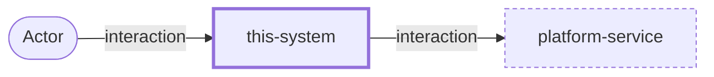

<!-- docs-kit: nav="Architecture" -->
# {{NAME}}: Architecture

{{NAV}}

{{META}}

<!--
TEMPLATE: docs/01-architecture.md (repository level)
Do not rename, reorder, add or remove the numbered H2 headings. H3 subsections may be added freely.
If a section does not apply, keep the heading and write: _Not applicable._ followed by one sentence saying why.
Describe the system as a whole. Each service's internals belong in its own 01-architecture.md; link to it.
-->

## 1. Overview

<What the system does, the architectural style (event-driven pipeline, set of APIs, ...), and the qualities
that shape the design (tenant isolation, idempotency, throughput, ...).>

## 2. System context

<!-- Required diagram: flowchart of the system as one box, with its actors and the external systems it uses. -->

| Actor or system | Relationship | Interface |
|---|---|---|
| <name> | <what it does with the system> | <GraphQL / NATS / GCS / ...> |

## 3. Service landscape

<!-- Required diagram: flowchart of every service in the repository and how they connect. -->

| Service | Responsibility | Talks to |
|---|---|---|
| <service> | <responsibility> | <services and stores> |

## 4. End-to-end flows

<!-- One H3 per flow that crosses services, primary path first, each with a sequenceDiagram (autonumber). -->

### 4.1 <Primary flow>

## 5. Deployment topology

<!-- Required diagram: flowchart of where each deployable runs (cluster, namespace) and what it connects to. -->

## 6. Cross-cutting concerns

<Concerns shared by every service: idempotency, tenancy, observability, error handling, configuration.>

## 7. Key design decisions

| Decision | Rationale | Reference |
|---|---|---|
| <decision> | <why, and the alternatives considered> | <document section, code or ticket> |

## 8. Known limitations

- <limitation, with ticket or file reference where one exists>
