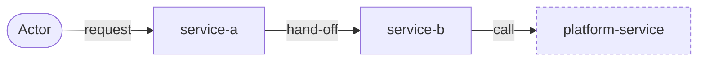

<!-- docs-kit: nav="Overview" -->
# {{NAME}}: Overview

{{NAV}}

{{META}}

<!--
TEMPLATE: docs/README.md (repository level)
Replace every <placeholder>. Delete these guidance comments when done.
Do not rename, reorder, add or remove the numbered H2 headings. H3 subsections may be added freely.
If a section does not apply, keep the heading and write: _Not applicable._ followed by one sentence saying why.
-->

<One or two paragraphs: what the system in this repository does as a whole, who uses it, and how its services
fit together.>

This directory holds the repository-level (platform) documentation. Each service has the same set of documents in its own `docs/` folder.

## 1. Services

<!-- One row per service under {{COMPONENTS_DIR}}/. The check fails when a service's docs/README.md is not
linked from this page, so add new services here. -->

{{SERVICE_TABLE}}

## 2. System at a glance

<!-- Required diagram: flowchart LR of the services and the main hand-offs between them, with external actors
(stadium shape) and platform services outside this repository (class ext). -->



<One or two sentences explaining the diagram, pointing to the architecture and messaging guides for detail.>

## 3. Platform documentation

| Document | Covers |
|---|---|
| [Architecture](01-architecture.md) | System context, service landscape, end-to-end flows, deployment topology, cross-cutting design |
| [Data model](02-data-model.md) | Core domain model, data flow and lineage, shared schemas, data stores, tenancy |
| [Messaging](03-messaging.md) | Messaging infrastructure, stream and subject catalog, KV buckets, conventions |
| [Authentication & authorization](04-authentication.md) | Callers, inbound authentication, permissions, tenancy, service-to-service credentials, secrets |
| [API](05-api.md) | API catalog, conventions, external APIs, health endpoints |
| [Configuration](06-configuration.md) | Shared conventions, per-service reference, dynamic configuration, environments |
| [Operations](07-operations.md) | CI/CD, runtime platform, observability, scaling, incident response, recovery |
| [Development](08-development.md) | Repository layout, dependencies, building and testing, branching and CI gates |
| [Glossary](09-glossary.md) | Terms used across the repository |
| [Documentation standards](10-documentation-standards.md) | How these documents are structured and kept current |

## 4. Service documentation

Every service documents itself with the same set of files:

{{SERVICE_MATRIX}}

## 5. Related documents

<!-- The documents in this directory and in each service's docs/ folder are the only maintained documentation
(documentation standards §7). List the other documentation kept with the code. Drop the paragraph about
removed documents if there never were any. -->

The documents in this directory and in each service's `docs/` folder are the only maintained documentation. Earlier documents (design records, ADRs, low-level designs and reports) were removed when this set was introduced; what they said about the current system now lives in these documents, and the originals remain in git history:

```bash
git log --diff-filter=D --name-only --oneline -- docs '{{COMPONENTS_DIR}}/*/docs'
```

Other related documents:

| Document | Covers |
|---|---|
| [Repository README](../README.md) | Landing page and service catalog |

## 6. Where to start

| You want to… | Read |
|---|---|
| Understand the system | This page, then [architecture](01-architecture.md) and [messaging](03-messaging.md) |
| Work on a service | The service's `docs/README.md`, then its `08-development.md` and the [development guide](08-development.md) |
| Investigate an incident | [Operations §6](07-operations.md#6-incident-response) and the service's `07-operations.md` |
| Write or review documentation | [Documentation standards](10-documentation-standards.md) |
